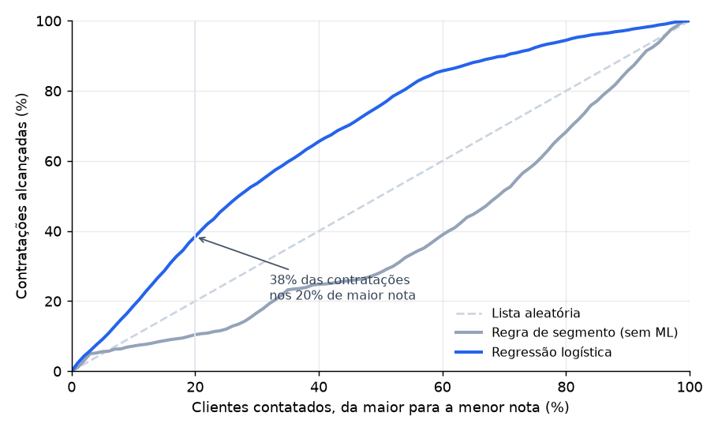
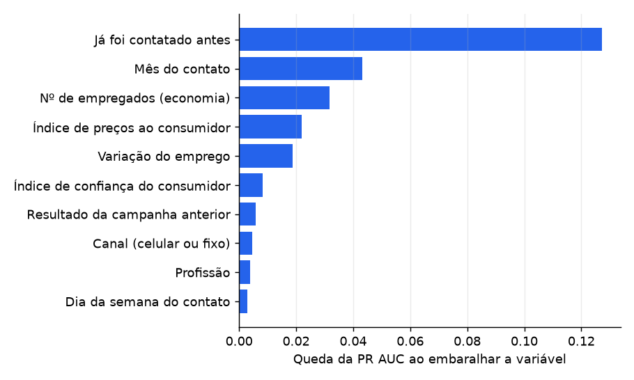
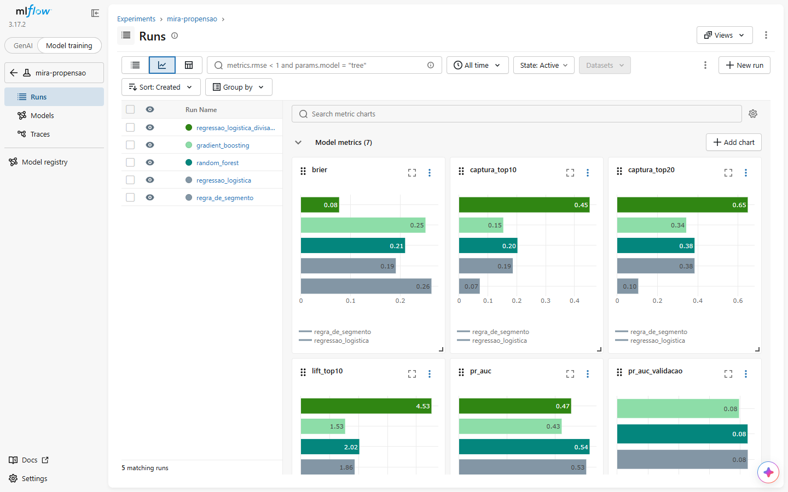

<h1 align="center">🎯 Mira</h1>

<p align="center">
  <b>Quem tem mais chance de contratar?</b> Um modelo de propensão para campanhas de um banco:<br>
  em vez de oferecer o produto para todo mundo, a lista de contato começa pelos clientes de maior nota.
</p>

<p align="center">
  <a href="../../actions/workflows/ci.yml"></a>
  
  
  
  
  
</p>

<p align="center">
  
</p>

## 🌎 In English

A propensity model for a bank's marketing campaigns, on the public **UCI Bank Marketing** dataset (41,188 calls,
2008–2010): who is most likely to subscribe a term deposit, so the call list starts with them.

- **Exploration in SQL** (SQLite): six business questions, each a `.sql` file, compiled into a report.
- **Honest evaluation**: the call `duration` is dropped (it is only known after the call and leaks the answer), the
  test set is the **most recent 20%** of the data, and the model is chosen by **time-based cross-validation** on the
  past only, with a parsimony tie-break.
- **Every experiment tracked in MLflow**: parameters, metrics, gain charts and the trained models.
- Result on the future: **ROC AUC 0.75**, and the top 20% of scores hold **38% of the subscriptions** (a random
  list would hold 20%). A random split would have reported 0.80: the difference is the cost of the future being
  different from the past.
- 19 tests and CI that downloads the data (SHA-256 checked), retrains and checks the published numbers.
  *Python · pandas · scikit-learn · MLflow · SQLite · matplotlib.*

*The rest of this README is in Portuguese.*

---

## 🎯 O problema

Uma campanha que liga para todos os clientes gasta tempo do time e incomoda quem não tem interesse. Nesta base,
de **41.188 ligações** de um banco português oferecendo um investimento (depósito a prazo), só **11,3%**
contrataram. A pergunta do modelo é: **para quem ligar primeiro?**

Cada cliente recebe uma nota (a probabilidade de contratar), e a lista de contato é ordenada por ela. É o mesmo
problema de "oferecer o produto certo para o cliente certo" de qualquer área comercial de banco ou cooperativa.

## 🔎 O que os dados mostram (em SQL)

A exploração é feita em **SQL**, numa tabela `clientes` no SQLite: cada pergunta é um arquivo em [`sql/`](sql), e
o relatório completo com as respostas está em [`docs/exploracao.md`](docs/exploracao.md).

| Pergunta | Resposta |
|---|---|
| Quem já contratou antes volta a contratar? | **65,1%** dos que tiveram sucesso na campanha anterior, contra 8,8% de quem nunca foi contatado |
| Insistir funciona? | Não: a taxa cai de **13,0%** na 1ª ligação para **5,5%** a partir da 6ª |
| Qual canal funciona melhor? | Celular, com **14,7%**, contra 5,2% no telefone fixo |
| O cenário econômico pesa? | Muito: com a Euribor abaixo de 1%, **45,7%** contrataram; acima de 3%, 4,8% |
| Em que idade a oferta pega? | Nas pontas: **24,0%** até 24 anos e **39,6%** a partir dos 60 |

## 🧪 Como o modelo é avaliado

Três decisões fazem a diferença entre um número bonito e um número que vale para a próxima campanha.

**1. Sem vazamento da resposta.** A base traz a duração de cada ligação, que é a variável que mais "prevê" a
contratação: quem fica muito tempo na linha quase sempre contrata. Mas ela só existe depois de ligar, e o
modelo precisa dar a nota *antes*. Ela sai das variáveis (a própria UCI recomenda isso), e um teste garante que
nunca volta.

**2. Treino no passado, teste no futuro.** As ligações estão em ordem de data. O treino usa os **80% mais
antigos** (2008 e 2009) e o teste os **20% mais recentes** (2010), como o modelo seria usado de verdade. Uma
divisão aleatória misturaria 2010 no treino de um modelo avaliado em 2008.

**3. Escolha pela validação, nunca pelo teste.** Cada modelo passa por uma **validação cruzada temporal** dentro
do treino (janelas que avançam no tempo). O de melhor PR AUC na validação é o escolhido; se dois empatam (diferença
menor que 0,005), fica **o mais simples**, que é mais fácil de explicar e de auditar. O teste só confirma a escolha.

As métricas: **ROC AUC** (o modelo ordena bem?), **PR AUC** (bom para classes raras, comparada com a taxa de
contratação do período), **Brier** (as probabilidades estão calibradas?) e as que o time comercial entende,
**captura** (que parte das contratações está no topo da lista) e **lift** (quantas vezes o topo supera a média).

## 📊 Resultados

No teste, com **8.238 clientes de 2010**, em que **30,8%** contrataram:

| Modelo | ROC AUC | PR AUC | Captura nos 20% de maior nota | Lift nos 10% de maior nota |
|---|---|---|---|---|
| Lista aleatória (referência) | 0,50 | 0,31 | 20% | 1,0× |
| Regra de segmento (sem ML) | 0,37 | 0,30 | 10% | 0,7× |
| **Regressão logística** ✅ escolhida | **0,75** | **0,53** | **38%** | **1,9×** |
| Random forest | 0,75 | 0,54 | 38% | 2,0× |
| Gradient boosting | 0,63 | 0,43 | 34% | 1,5× |

**O que esses números contam:**

- **O futuro é diferente do passado.** A taxa de contratação foi de **6,4%** no treino para **30,8%** no teste, e
  quem recebeu as ligações também mudou: a Euribor ficou entre 0,63% e 1,30% no teste, contra 1,30% a 5,04% no
  treino; os clientes já contatados antes passaram de 0,5% para 16,3%; e o celular, de 57% para 88% das
  ligações. Um modelo que só funciona nas condições em que foi treinado não serve para a campanha seguinte.
- **A regra de segmento quebrou.** Ela dá a cada cliente a taxa histórica do seu grupo (campanha anterior, canal e
  faixa de juros), como uma planilha faria. No futuro ela ficou **pior que uma lista aleatória**: nenhuma ligação
  do treino teve juros abaixo de 1%, e quase metade das do teste teve.
- **As árvores sofrem para extrapolar.** O gradient boosting caiu para 0,63: árvores não extrapolam quando os
  indicadores econômicos saem da faixa que viram no treino. A regressão logística generalizou melhor.
- **Logística e floresta empataram na validação** (0,0849 contra 0,0848), e a logística ficou pela parcimônia. No
  teste a floresta teve PR AUC um pouco maior (0,54 contra 0,53), mas trocar de modelo por causa disso seria usar o
  teste para decidir.

**Quanto a divisão aleatória engana.** O mesmo modelo, avaliado com treino e teste sorteados, como em muito
tutorial:

| Divisão | ROC AUC | Brier |
|---|---|---|
| Aleatória (otimista) | 0,80 | 0,08 |
| **Temporal (como será usado)** | **0,75** | **0,19** |

O ROC AUC cai de 0,80 para 0,75, e o Brier piora bastante: as probabilidades aprendidas num período de 6% de
contratação ficam baixas num período de 31%. A ordenação continua útil, mas a probabilidade precisa ser
**recalibrada** com dados recentes antes de virar meta de vendas.

### O que mais pesa na nota

<p align="center">
  
</p>

Importância por permutação no teste (quanto a PR AUC cai quando a variável é embaralhada). **Já ter sido contatado
antes** pesa mais que todo o resto junto; depois vêm o **mês** e os **indicadores econômicos**, o que explica a
dificuldade com o período novo: o contexto econômico muda a propensão de todo mundo ao mesmo tempo.

## 🧭 MLflow

Cada modelo é uma execução no MLflow, com parâmetros, métricas, a curva de ganho e o modelo treinado (salvo com
skops, liberando só os tipos das árvores treinadas aqui). A divisão aleatória fica registrada à parte, marcada como
comparação, e o modelo escolhido ganha a tag `escolhido`.

<p align="center">
  
</p>

## ▶️ Rodando

Precisa do [uv](https://docs.astral.sh/uv/). A base é baixada da UCI na primeira vez, e o SHA-256 é conferido.

```bash
uv sync
uv run mira-explorar     # consultas SQL -> docs/exploracao.md
uv run mira-treinar      # 4 modelos + comparação, registrados no MLflow -> docs/resultados.json e docs/img/
uv run mlflow ui --backend-store-uri sqlite:///mlflow.db   # abre os experimentos em http://127.0.0.1:5000
uv run pytest            # 19 testes, com dados sintéticos (sem internet)
```

## 📁 Estrutura

```
sql/                  as perguntas de negócio, uma consulta por arquivo
src/mira/
  dados.py            download conferido por SHA-256, leitura e cópia para o SQLite
  exploracao.py       roda sql/*.sql e gera docs/exploracao.md
  preparo.py          variáveis, retirada do vazamento e divisão temporal
  metricas.py         captura, lift e curva de ganho
  treino.py           modelos, validação temporal, escolha, MLflow e comparação com divisão aleatória
  graficos.py         curva de ganho e importância
  conferir.py         o CI confere se um treino novo reproduz os números publicados
tests/                19 testes
dados/README.md       fonte, licença e SHA-256 da base
```

## ✅ Testes e CI

- **19 testes** com dados sintéticos: a duração da ligação nunca chega ao modelo, `pdays = 999` vira "nunca
  contatado" (e não 999 dias), o teste é sempre o futuro do treino, as métricas de captura e lift, a escolha com
  desempate, e o treino completo registrando tudo no MLflow.
- **CI** em três etapas: lint (Ruff, com as regras de segurança do Bandit) e testes; treino com a base real, que
  confere se os números batem com os deste README e publica os experimentos do MLflow como artefato; e varredura
  de vulnerabilidades no `uv.lock` (osv-scanner). Actions fixadas por SHA e Dependabot semanal.

## 📄 Dados

Moro, S., Rita, P. e Cortez, P. (2014). *Bank Marketing*. UCI Machine Learning Repository.
[doi.org/10.24432/C5K306](https://doi.org/10.24432/C5K306), licença CC BY 4.0. Os dados são anônimos; mais
detalhes em [`dados/README.md`](dados/README.md).
